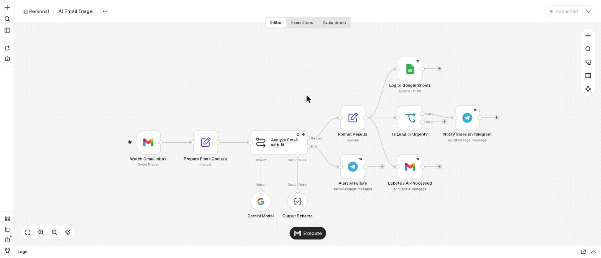
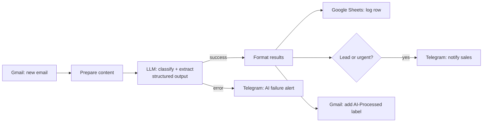
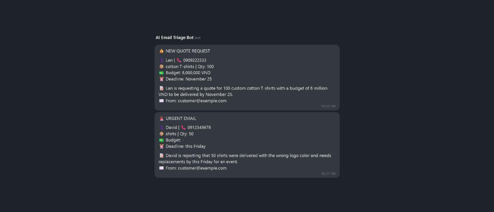

# AI Email Triage with n8n

An n8n automation that reads incoming sales emails, uses an LLM to classify them and extract structured data, logs every email to Google Sheets, and alerts the sales team on Telegram when a new lead or an urgent issue arrives.

It works with emails written in **Vietnamese or English**. Summaries and alerts are always produced in English.



## The problem

Small businesses often receive quote requests, complaints, questions and spam in one shared inbox. Someone has to read every email, copy the key details into a spreadsheet and decide what needs attention first. Leads get missed and urgent complaints wait too long.

## The solution

Every 5 minutes the workflow checks the inbox and, for each new email:

1. **Classifies** it as `quote_request`, `complaint`, `question` or `spam`
2. **Extracts** customer name, phone, product, quantity, budget, deadline, urgency and language
3. **Summarizes** it in one English sentence
4. **Logs** everything as a new row in Google Sheets
5. **Alerts** the team on Telegram when it is a quote request or an urgent email
6. **Labels** the email `AI-Processed` in Gmail so nothing is handled twice



## Example

**Input email (Vietnamese):**
> Công ty mình đang cần in 100 áo thun đồng phục có in logo 2 mặt... Ngân sách khoảng 8 triệu đồng, cần giao trước ngày 25/11... Lan – SĐT: 0909 222 333

**Extracted data:**

| Field | Value |
|---|---|
| intent | `quote_request` |
| customer_name | Lan |
| phone | 0909222333 |
| product | cotton t-shirts with 2-sided logo printing |
| quantity | 100 |
| budget_vnd | 8000000 |
| deadline | 25/11 |
| urgency | medium |
| language | vi |
| summary | Lan is requesting a quote for 100 cotton t-shirts with 2-sided logo printing for a company event by November 25th. |

**Telegram alerts:**



## Features

- **Structured extraction**: a JSON schema output parser guarantees consistent fields and allowed values, with `null` instead of invented data
- **Multilingual**: Vietnamese and English input, English output
- **Reliable**: retry on failure (3 attempts) for every external service, a separate error branch so one bad email never blocks the rest, and a global **Error Handler** workflow that reports any failure to Telegram
- **No double processing**: only unread emails are fetched, and processed emails are labeled
- **Model-agnostic**: uses Google Gemini by default; switch to Claude (Anthropic Chat Model) or OpenAI by replacing a single sub-node

## Tech stack

n8n (self-hosted with Docker) · Gmail API · Google Sheets API · Google Gemini (LLM) · Telegram Bot API · JavaScript expressions · JSON Schema

## Setup

1. Run n8n:
   ```bash
   docker compose up -d
   ```
2. In n8n, create credentials for **Gmail OAuth2**, **Google Sheets OAuth2**, **Google Gemini** (or another chat model) and **Telegram**.
3. Import `workflows/error-handler.json` and `workflows/ai-email-triage.json` (Workflows → Import from file).
4. Replace the placeholders:
   - `YOUR_TELEGRAM_CHAT_ID` in the three Telegram nodes
   - `YOUR_GOOGLE_SHEET_URL` in **Log to Google Sheets**
   - `YOUR_GMAIL_LABEL_ID` in **Label as AI-Processed** (create an `AI-Processed` label in Gmail, then pick it from the list)
5. Create a Google Sheet with these column headers:
   `received_at, from, subject, intent, customer_name, phone, product, quantity, budget_vnd, deadline, urgency, language, summary`
6. Publish **Error Handler**, select it under **AI Email Triage → Settings → Error Workflow**, then publish **AI Email Triage**.
7. Send yourself one of the emails in [`sample-emails.md`](sample-emails.md) to test.

## Customization ideas

- Change the categories and the system prompt for any business (real estate, clinics, e-commerce, B2B sales)
- Create leads directly in a CRM (HubSpot, Pipedrive) instead of, or in addition to, Google Sheets
- Draft an automatic first reply for each quote request
- Route alerts to Slack, Microsoft Teams or email

## Author

Built by **Minh Tuan Tran**, full-stack developer (Node.js/TypeScript, Java Spring Boot, React) specializing in e-commerce systems and AI automation.
